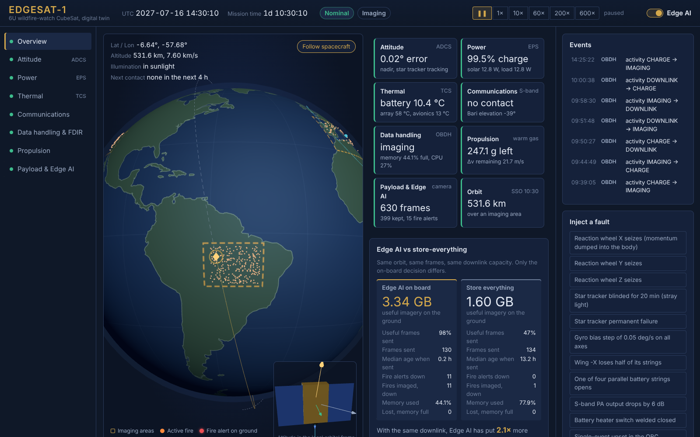
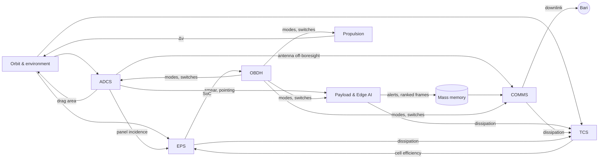
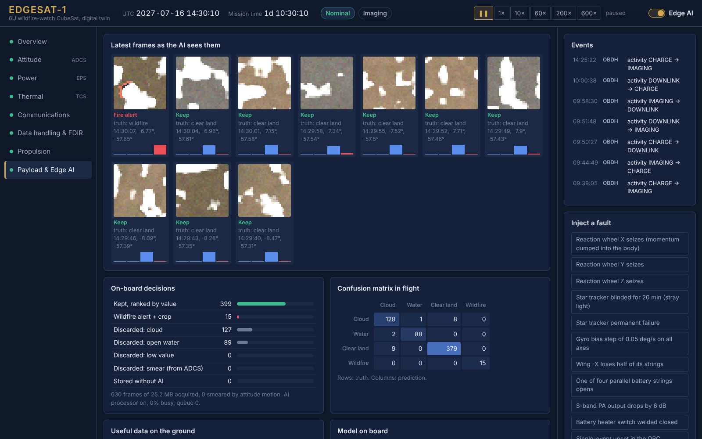

# EDGESAT-1 — a full-spacecraft digital twin with on-board Edge AI

**A 6U Earth-observation CubeSat that watches for wildfires, simulated subsystem by
subsystem, with a mission-control dashboard and an int8 neural network that decides
on board what is worth sending to the ground.**



Small satellites can take far more pictures than they can send home. In this mission
the camera acquires about 8 GB a day while a single low-cost ground station receives
about 2.4 GB, and the 16 GB on-board memory fills in two days. Two thirds of the planet is cloudy at any moment, so a
conventional satellite spends most of its downlink on images nobody will use, and a
fire that started this morning waits in a queue behind them.

EDGESAT-1 moves the first step of the analysis into orbit. Every frame is classified
by a 4 KB convolutional network running in integer arithmetic; clouds and open water
are dropped, wildfires trigger a 12 kB alert that jumps the queue, and everything else
is ranked by expected value. The project simulates the whole spacecraft around that
idea, because whether on-board AI is worth it is a systems question: it depends on
pointing, power, heat, memory, link budget and operations, not on the model alone.

## Results

Two satellites fly the same orbit through the same weather and the same wildfires and
downlink to the same ground station in Bari. The only difference is the on-board AI.
5-day run, `python scripts/run_mission.py --days 5`:

| | Edge AI on board | Store everything |
|---|---:|---:|
| Data downlinked (20 passes over Bari) | 12.0 GB | 12.0 GB |
| Useful share of the frames sent | **98%** | 59% |
| Useful imagery on the ground | **11.8 GB** | 7.0 GB |
| Median age of a frame when it reaches the ground | **3.7 h** | 54.6 h |
| Frames lost because the memory was full | 45 | 924 |
| Wildfires imaged | 35 | 35 |
| Wildfires known on the ground | **35** | 11 |
| Median time from imaging to the ground | **3.6 h** | 61.9 h |
| False fire alerts | 0 | — |


The AI processor used 5.1 Wh in 5 days, 0.7% of the spacecraft's energy. Full table and figures: [docs/results.md](docs/results.md).

## What is simulated

Every subsystem is modelled from first principles and coupled to the others, one
step per second.

| Subsystem | Model |
|---|---|
| **Orbit & environment** | Cowell RK4 with J2, drag on the attitude-dependent area and thrust; analytical Sun ephemeris, conical eclipses, IGRF dipole field, exponential atmosphere; Natural Earth land mask, evolving cloud field, Poisson wildfires |
| **ADCS** | Rigid body + 3 reaction wheels + 3 magnetorquers; gravity-gradient, aerodynamic, solar-pressure and magnetic disturbance torques; gyro, star tracker (Sun/Earth exclusion), Sun sensors, magnetometer; **multiplicative EKF**; rate-limited quaternion feedback, B-dot, momentum dumping, wheel-failure reallocation |
| **EPS** | Temperature-dependent solar cells, MPPT with curtailment, Li-ion pack with OCV curve and internal resistance, switched loads (LCLs), cold-charge inhibit |
| **TCS** | 6-node lumped thermal network: direct Sun, albedo, Earth IR, radiation to space, conduction, dissipation of each unit in its node, thermostatic heaters |
| **COMMS** | S-band link budget every second (EIRP, attitude-dependent antenna gain, free-space and atmospheric loss, G/T), adaptive coding & modulation, Doppler, pass logging |
| **OBDH** | Mode manager (LEOP, safe, nominal, reboot), on-board planner with orbit look-ahead, 16 GB mass memory with priority queue, housekeeping |
| **FDIR** | 12 detectable faults with autonomous isolation and recovery (wheel seizure, star-tracker loss, heater stuck on, OBC upset, valve leak, AI hang, low battery, tumbling…) |
| **Propulsion** | Warm-gas thruster, rocket equation, misalignment torque; autonomous orbit maintenance on the mean semi-major axis |
| **Payload & Edge AI** | 4-band camera with smear from the attitude motion; int8 CNN (3 916 parameters, 96.4% validation accuracy, 98% wildfire recall), inference cost model, value-ranked storage |



The full engineering rationale — requirements, orbit selection, mass, power, link and
data budgets, equations, FDIR table and known limitations — is in
[docs/mission_design.md](docs/mission_design.md).

## Run it

Python 3.11 or newer.

```bash
git clone https://github.com/<your-user>/edgesat-twin.git
conda create -n edgesat python=3.12 -y
conda activate edgesat
cd edgesat-twin
pip install -r requirements.txt
python -m server.app            # open http://localhost:8000
```

Options: `--scenario leop` starts right after separation from the launcher (tumbling
at 5°/s), `--warp 200` sets the initial time acceleration.



The dashboard has a view per subsystem: a 3D globe and ground track, attitude in the
local orbital frame, live strip charts, the attitude matrix and the MEKF covariance,
the thermal conductance matrix, the link budget and sky plot, the mode diagram, the
frames exactly as the AI sees them with its decision, and a live confusion matrix.
From the right-hand rail you can inject any of the faults and watch FDIR react.

Headless:

```bash
pip install -r requirements-dev.txt
python scripts/run_mission.py --days 5   # AI vs baseline, writes docs/results.md and figures
python scripts/train_model.py            # retrain and re-quantise the on-board model (~3 min)
pytest -q                                # 32 tests
```

```python
from edgesat.sim import Simulation

sim = Simulation(scenario="nominal")
sim.run(3 * 3600)
sim.command("inject", "wheel_x_seize")
sim.run(600)
print(sim.sc.obdh.mode, sim.sc.adcs.tm["pointing_error_deg"])
```

## Repository

```
config/mission.toml      every parameter of the mission and spacecraft
edgesat/core/            attitude maths, orbit propagation, environment models
edgesat/subsystems/      adcs, eps, tcs, comms, obdh, propulsion, payload
edgesat/ai/              scene generator, NumPy CNN, int8 quantisation, trained model
edgesat/spacecraft.py    the coupled step of all subsystems
edgesat/sim.py           driver, telemetry, commands
server/app.py            real-time runner with time warp, SSE telemetry stream
web/                     mission-control dashboard (three.js, uPlot, vanilla JS)
scripts/                 mission comparison, model training, land-data builder
docs/                    mission design, results, figures
tests/                   unit and integration tests
```

No dependency beyond NumPy, Starlette and Uvicorn at run time; the CNN, its training
and its int8 inference are written from scratch in NumPy.

## Engineering notes

- **Why simulate the whole spacecraft for an AI payload?** Because the payload's value
  is decided elsewhere. Smear from the ADCS makes frames useless before any model sees
  them, so the AI discards them using attitude telemetry alone. Imaging and downlink
  over the same region compete for the pointing of one spacecraft. The AI processor's
  heat lands in the avionics node. The planner must know the next pass to slew in time.
- **The MEKF is the right estimator** for a star-tracker-plus-gyro ADCS: when the star
  tracker is blinded, the covariance matrix in the dashboard shows how the attitude
  becomes poorly observable about the magnetic field direction during eclipses.
- **Honest limits.** The imagery is procedural and the classifier is trained and tested
  on the same generator, so its accuracy is an upper bound. The models are the
  simplified ones used in phase-A studies, not flight-qualified tools. Section 9 of the
  design document lists every simplification.

## Roadmap

- Hardware-in-the-loop: run the ADCS controller and the int8 model on an STM32 over a serial link.
- Train on real Sentinel-2 / Landsat tiles and evaluate on held-out regions.
- Cloud-mask segmentation and on-board compression of the kept frames.
- Second ground station and an optical intersatellite link for sub-hour fire alerts.

## Author

Giovanni Pio Martello — Computer and Automation Engineering, Politecnico di Bari.

Released under the MIT License. Land data from Natural Earth (public domain);
three.js and uPlot are MIT-licensed (see `web/vendor`).
