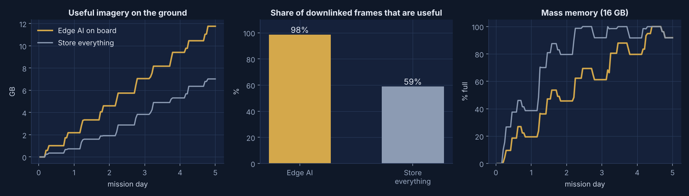
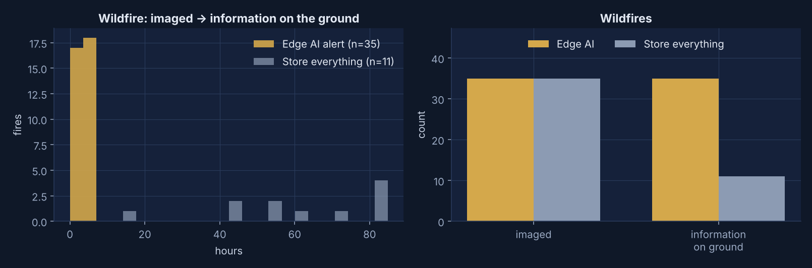
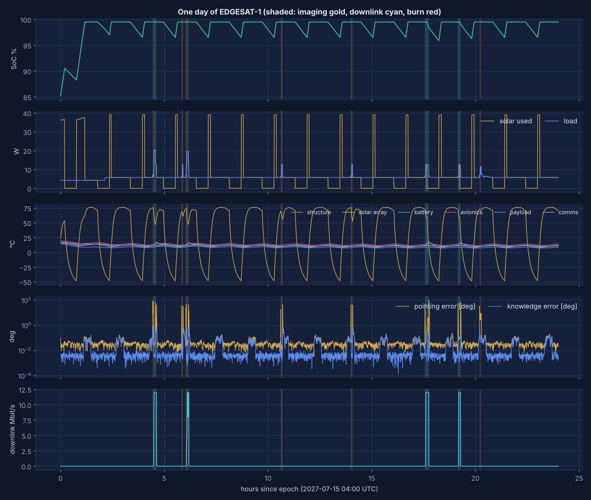

# Mission results: 5.0 days, seed 42

Generated by `python scripts/run_mission.py`. Both satellites fly the same orbit through the same
weather and wildfires and downlink to the same ground station; only the on-board AI differs.

| Metric | Edge AI on board | Store everything |
|---|---:|---:|
| Frames acquired | 1623 | 1623 |
| Data downlinked (same passes) | 11.99 GB | 11.99 GB |
| Full frames delivered | 463 | 474 |
| Useful frames delivered | 456 | 279 |
| Useful share of delivered frames | 98% | 59% |
| Useful imagery on the ground | 11.76 GB | 7.02 GB |
| Median age of a frame when it reaches the ground | 3.7 h | 54.6 h |
| Frames lost to full memory | 45 | 924 |
| Memory fill at end | 92% | 92% |
| Wildfires imaged | 35 | 35 |
| Wildfires with information on the ground | 35 | 11 |
| Median time, imaged → on the ground | 3.6 h | 61.9 h |
| False fire alerts delivered | 0 | n/a |
| Energy used by the AI processor | 5.1 Wh | 0 Wh |
| Total energy consumed | 717 Wh | 717 Wh |
| Minimum battery state of charge | 85% | 85% |
| Ground-station passes / orbit-maintenance burns | 20 / 2 | 20 / 2 |

